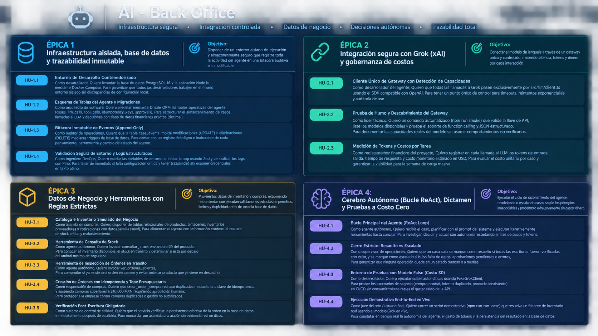

<p align="center">
  
</p>

<p align="center">
  
  
  
  
  
  
  
</p>

---

# 🍌 AI Back Office Agent — Nano Banana

> **Agente autónomo de operaciones de back office (inventario, compras, auditoría y abastecimiento)** impulsado por **Grok (xAI)** con toma de decisiones ReAct, ejecución estricta de herramientas y verificación directa en base de datos.

---

## 👥 Contribuidores

<table align="center">
  <tr>
    <td align="center">
      <a href="https://github.com/DMntill4">
        <br />
        <sub><b>Diego Mantilla</b></sub>
      </a><br />
      <code>@DMntill4</code>
    </td>
    <td align="center">
      <a href="https://github.com/andresguerra321">
        <br />
        <sub><b>Andrés Guerra</b></sub>
      </a><br />
      <code>@andresguerra321</code>
    </td>
  </tr>
</table>

---

## ⚡ Estado del Proyecto (Semana 1: Agente End-to-End)

El agente cuenta con su ciclo cognitivo y de ejecución completo:
- [x] **Infraestructura aislada en Docker:** PostgreSQL 16 con esquemas Drizzle ORM y triggers inmutables.
- [x] **Configuración y Logs:** Validación estricta con **Zod** y telemetría estructurada con **Pino**.
- [x] **Cliente Grok:** Conexión segura en `src/llm/client.ts`, detección de capacidades y contención de costos.
- [x] **Herramientas de negocio:** `consultar_stock`, `ver_ordenes_abiertas`, `crear_orden_compra` con **idempotencia**, límites de dinero ($10,000 MXN) y verificación post-escritura.
- [x] **Cerebro ReAct (`loop.ts`):** Ciclo autónomo de razonamiento, ejecución de herramientas y dictamen (`resuelto` vs `escalado`).
- [x] **Pruebas a costo $0:** 20 tests unitarios y de escenarios ejecutados con `FakeGrokClient`.

---

## 🛠️ Stack Tecnológico

<div align="center">

| Categoría | Tecnología | Insignia |
|:---|:---|:---:|
| **Inteligencia Artificial** | xAI Grok (`grok-4.6`) |  |
| **Lenguaje y Entorno** | TypeScript 5.6 + Node.js (LTS) |   |
| **Base de Datos & ORM** | PostgreSQL 16 + Drizzle ORM |   |
| **Aislamiento & DevOps** | Docker + Docker Compose |  |
| **Validación & Logs** | Zod + Pino |   |
| **Testing & Calidad** | Vitest + ESLint + Prettier |   |

</div>

---

## 📋 Arquitectura y Flujo del Agente

```text
Caso Entrante ──► PostgreSQL (Estado: "recibido")
                      │
              Agent Loop (ReAct) ──► LLM Client ──► Grok (xAI)
               │          ▲              │
  Selección de │          │ Resultado    └─► Auditoría en llm_calls (costos & tokens)
  Herramientas ▼          │
              Herramientas ──► Servicios ──► PostgreSQL (Negocio)
                      │
               Verificación ──► case_events ──► Dictamen: "resuelto" | "escalado"
```

### Principios No Negociables
1. **El modelo decide, el código gobierna:** Grok no toca la base de datos directamente; solicita herramientas y el código aplica permisos y límites.
2. **Idempotencia:** Toda acción de escritura requiere una clave de idempotencia única; repetir la llamada nunca duplica transacciones.
3. **Verificación Post-Escritura:** Un caso solo se cierra como `resuelto` si la inserción en base de datos es comprobada en disco.
4. **Límite de Aprobación Humana:** Compras superiores a **$10,000 MXN** son suspendidas inmediatamente y escaladas a supervisión.

---

## 🗺️ Historias de Usuario y Épicas

<p align="center">
  
</p>

<details>
<summary><b>📖 Ver desglose de Épicas de Desarrollo</b></summary>

- **Épica 1: Infraestructura Aislada & Base de Datos Inmutable**
  - Contenedores Docker para Postgres 16 y Node.js.
  - Tablas operativas del agente (`cases`, `case_events`, `llm_calls`, `tool_calls`, `idempotency_keys`, `approvals`).
  - Triggers inmutables que impiden `UPDATE` y `DELETE` en la bitácora de eventos.
- **Épica 2: Conexión Segura con Grok & Control de Costos**
  - Cliente único `client.ts` con manejo de timeouts, retries y cálculo de costos en USD.
  - Smoke test (`npm run smoke`) para inspección de gateway y modelos disponibles.
- **Épica 3: Datos de Negocio & Herramientas Estrictas**
  - Catálogo de productos, bodegas, inventario y cotizaciones de proveedores.
  - Herramientas `consultar_stock`, `ver_ordenes_abiertas` y `crear_orden_compra`.
- **Épica 4: Cerebro ReAct & Pruebas Automáticas a Costo $0**
  - Bucle iterativo de agente con prompts operacionales y reglas de cierre.
  - Suite de 20 tests automáticos ejecutados sin consumir saldo de la API.
</details>

---

## 🚀 Comandos Rápidos

### 1. Demostración en Vivo End-to-End (API Real de Grok)
```bash
npm run run-case
```
> Ejecuta un caso real de faltante de stock, consulta a Grok en vivo, ejecuta las herramientas y resuelve el caso en la base de datos con telemetría en tiempo real.

### 2. Pruebas Automáticas y Verificación
```bash
# Validar tipos de TypeScript
npm run typecheck

# Correr suite de pruebas con LLM simulado (Costo $0 USD)
npm test

# Ejecutar prueba de humo del Gateway de Grok
npm run smoke
```

### 3. Entorno Aislado con Docker & Base de Datos
```bash
# Construir y levantar contenedores
docker compose up --build -d

# Ejecutar migraciones de base de datos
npm run db:migrate

# Poblar datos iniciales de prueba (seed)
npm run db:seed

# Explorar base de datos visualmente
npm run db:studio
```

---

<p align="center">
  <sub>Desarrollado con dedicación para el Reto de Agentes Autónomos • 2026</sub>
</p>
