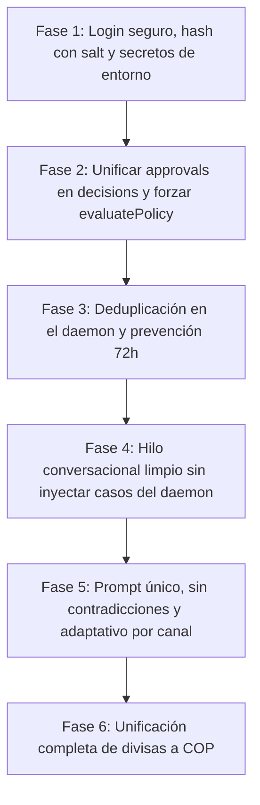

# PLAN DE ACCIÓN Y REMEDIACIÓN TÉCNICA: MINT BACK OFFICE

> **Origen:** Auditoría técnica realizada en entorno clon local con PostgreSQL real y captura de trazas del modelo.  
> **Fecha:** 26 de Octubre de 2026  
> **Estado:** Aprobado para ejecución  
> **Objetivo:** Eliminar el vacilar del agente autónomo, corregir vulnerabilidades críticas de autenticación y gobernanza presupuestal, resolver proliferación de casos en el daemon y unificar el dominio operacional a Pesos Colombianos (COP).

---

## 1. Diagnóstico de Causas Raíz

### 1.1 Por qué el Bot Vacila (Desorientación Cognitiva)
1. **Contexto envenenado (`packages/core/src/agent/loop.ts`):**  
   El bucle inyectaba los últimos 3 registros de la tabla `cases` de la empresa como mensajes de rol `user`. Cuando el daemon detectaba desabastos ("El stock actual (1u) es menor o igual al umbral..."), el LLM recibía esas alertas del sistema creyendo que eran preguntas previas del usuario, quebrando la coherencia conversacional.
2. **Ausencia de hilo de conversación:**  
   Cada mensaje en la consola o API abría un caso nuevo desconectado del anterior. Consultas de seguimiento como *"¿y el de Medellín?"* perdían el contexto previo.
3. **Contradicciones en el prompt (`base.md`):**  
   - Exige *"usa solo la herramienta estrictamente necesaria"* mientras en otra sección exige *"siempre que menciones un producto debes informar su stock físico y mínimo"*, obligando a invocar herramientas redundantes (`consultar_stock` aun si solo se pedía comparar proveedores).
   - Afirma *"CERO compras automáticas"* mientras el código auto-compraba en modo `assisted`.
   - Redactado con restricciones para VT100 de terminal (*"no uses tablas con tuberías"*), aun comunicándose con interfaces web o Discord/Telegram.
4. **Configuración muerta (no cargada):**  
   Archivos críticos como `instructions.yaml`, `skills/*.md` (incluyendo `security_guardrails.md`), `superpowers.ts` y `pricing.ts` nunca eran leídos ni inyectados al modelo.
5. **Cierre prematuro como "resuelto":**  
   Cualquier respuesta en texto sin llamadas a herramientas contaba como caso `resuelto`, incluso ante respuestas preliminares ("voy a revisar..."). Al alcanzar 6 pasos sin emitir dictamen explícito, el caso se escalaba con un mensaje genérico.
6. **Errores del LLM no capturados:**  
   Si la API del modelo arrojaba un error, el caso permanecía en estado `en_proceso` indefinidamente. Bloques `catch {}` vacíos ocultaban fallos en la capa de datos.

---

### 1.2 Fallos Críticos de Seguridad y Gobernanza
1. **Login sin verificación de contraseña:**  
   `loginCommand` (`packages/cli/src/commands/login.ts`) únicamente buscaba el correo del usuario, ignoraba la contraseña y emitía un token inventado `mint_jwt_<uuid>`.
2. **Contraseñas almacenadas en texto plano:**  
   En `onboarding.ts` y `authAndSetupService.ts`, el campo `passwordHash` almacenaba la contraseña en texto plano sin salt ni derivación de claves.
3. **Secreto criptográfico por defecto en código:**  
   En `tokenService.ts`, la firma de tokens HMAC utilizaba un secreto de respaldo en código (`"mint-autonomous-secret-token-sign-key-2026"`).
4. **Compras sin aprobación desde el chat:**  
   En `policyEngine.ts`, el nivel de autonomía `assisted` evaluaba compras por debajo del umbral como `auto_executed` en lugar de exigir aprobación humana en `/inbox`.
5. **Aprobaciones desincronizadas (`approvals` vs `decisions`):**  
   `inventoryService.ts` persistía en la tabla `approvals`, mientras que `mint inbox` leía de `decisions`. Al fallar silenciosamente la inserción en `decisions`, la propuesta quedaba huérfana en `approvals` y nadie la veía.
6. **Proliferación descontrolada en el Daemon:**  
   `scanStockDeficits` en `packages/daemon/src/triggers.ts` iteraba cada 30 segundos sobre todos los productos en déficit y creaba nuevos casos y decisiones sin verificar si ya existía una propuesta pendiente o una orden en tránsito para ese SKU.
7. **Bypass de prevención de duplicados (72 horas):**  
   Al ser la `idempotency_key` inventada por el LLM en cada interacción, la misma orden se duplicaba ignorando la regla de 72 horas.

---

### 1.3 Inconsistencias de Dominio y Divisas
1. **Menciones de MXN:**  
   Más de 140 menciones de `MXN` en esquemas, configuraciones de negocio (`business_config`) y adaptadores en un sistema diseñado para Colombia.
2. **Umbral sembrado incorrecto:**  
   El asistente sembraba un umbral de `$10,000 MXN` en lugar de `$5,000,000 COP`.
3. **Métricas simuladas:**  
   `getSupplierPerformance` generaba puntajes con la fórmula artificial `idx * 3 % 14`, y compras directas asumían un precio base de 250 MXN.

---

## 2. Plan de Remediación en 6 Fases

---

### Fase 1: Autenticación Segura, Hash Criptográfico y Secretos de Entorno
* **Objetivo:** Garantizar que ninguna sesión ni API web se exponga sin validación criptográfica estricta.
* **Archivos Afectados:**
  - `packages/core/src/utils/crypto.ts` *(nuevo módulo de hashing)*
  - `packages/core/src/services/authAndSetupService.ts`
  - `packages/cli/src/commands/onboarding.ts`
  - `packages/cli/src/commands/login.ts`
  - `packages/notifiers/src/tokenService.ts`
* **Acciones:**
  1. Crear `hashPassword(password: string): string` y `verifyPassword(password: string, storedHash: string): boolean` utilizando `crypto.scryptSync` y salt aleatorio de 16 bytes con comparación temporalmente segura (`timingSafeEqual`).
  2. Almacenar exclusivamente contraseñas hasheadas en `users.passwordHash`.
  3. Modificar `loginCommand` para requerir y verificar la contraseña contra el hash de base de datos.
  4. En `tokenService.ts`, requerir obligatoriamente `process.env.AUTH_SECRET` en producción; si falta en desarrollo, generar y advertir sobre el uso de un secreto efímero local sin valores fijos en el repositorio.

---

### Fase 2: Gobernanza en `crear_orden_compra` y Fuente Única `decisions`
* **Objetivo:** Toda compra debe someterse a `evaluatePolicy`, registrarse en `decisions` y requerir aprobación en `/inbox` en modo asistido.
* **Archivos Afectados:**
  - `packages/core/src/services/inventoryService.ts`
  - `packages/core/src/policy/policyEngine.ts`
  - `packages/core/src/tools/crearOrdenCompra.ts`
  - `packages/core/src/db/schema/agent.ts`
* **Acciones:**
  1. Modificar `policyEngine.ts` para que en modo `assisted` (y `dry-run`), toda propuesta de orden de compra retorne `pending_approval` hacia la bandeja `/inbox`. Solo en modo `auto` explícito y bajo el umbral ($5,000,000 COP) se permite `auto_executed`.
  2. Eliminar escrituras secundarias a la tabla `approvals`; consolidar la tabla `decisions` como fuente única de verdad para el motor HITL y `mint inbox`.
  3. Eliminar los bloques `catch {}` silenciosos en `createPurchaseOrder`. Exponer excepciones reales de base de datos con tipado explícito.
  4. Enriquecer la verificación de duplicados de 72 horas para auditar la combinación `(productId, supplierId, fecha)` directamente en PostgreSQL, sin depender de la clave generada por el LLM.

---

### Fase 3: Deduplicación en el Daemon y Protección de Ciclo
* **Objetivo:** Evitar la creación masiva de casos y decisiones redundantes para productos con déficit no resuelto.
* **Archivos Afectados:**
  - `packages/daemon/src/triggers.ts`
  - `packages/core/src/agent/coordinador.ts`
* **Acciones:**
  1. En `scanStockDeficits`, consultar antes de coordinar si para ese `productId` y `companyId` ya existe:
     - Una decisión en estado `pending_approval`.
     - Un caso en estado `en_proceso`.
     - Una orden de compra abierta o guía en estado `en_transito`.
  2. Si existe un proceso activo en curso, emitir registro de trazabilidad en log y omitir la creación de un nuevo caso/decisión.
  3. Aplicar la misma regla de deduplicación a `scanDelayedShipments`.

---

### Fase 4: Hilo Conversacional Limpio y Manejo Robusto de Errores
* **Objetivo:** Proporcionar memoria contextual real sin mezclar eventos del daemon y capturar fallos de API.
* **Archivos Afectados:**
  - `packages/core/src/agent/loop.ts`
  - `packages/cli/src/commands/console.ts`
  - `packages/api/src/routes/telemetry.ts`
* **Acciones:**
  1. **Eliminar la inyección de casos de fondo como diálogo de usuario:** Suprimir la consulta ciega de `cases` en `loop.ts`.
  2. **Soporte de hilo conversacional:** Permitir el paso de `threadId` o historial explícito de mensajes del usuario en la sesión interactiva.
  3. **Gestión de fallos de LLM:** Si la llamada a `client.chatCompletion` falla o agota reintentos, capturar el error, marcar el caso con `status: "error"` y persistir el motivo en `caseEvents`.
  4. **Diferenciación de respuestas:** Si el modelo responde texto explicativo sin invocar herramientas de cierre (`resolver_caso` o `escalar_caso`), clasificar la interacción como respuesta conversacional interactiva en lugar de cerrar el caso como resuelto.

---

### Fase 5: Unificación de Prompt y Activación de Guardrails Muertos
* **Objetivo:** Crear un prompt base sin contradicciones internas, cargar las reglas dormidas y formatear según el canal.
* **Archivos Afectados:**
  - `packages/core/src/agent/prompts/base.md`
  - `packages/core/src/agent/superpowers.ts`
  - `packages/core/src/agent/loop.ts`
* **Acciones:**
  1. Resolver las contradicciones de `base.md`:
     - Mantener la directiva de precisión quirúrgica (usar solo la herramienta requerida por la pregunta).
     - Flexibilizar el reporte de stock a cuando la pregunta lo amerite o cuando se discuta reabastecimiento directo.
  2. Conectar e inyectar las directivas de `security_guardrails.md` e `instructions.yaml` dentro del ensamblado del system prompt en `loadSystemPrompt()`.
  3. Adaptar el formato de respuesta por canal:
     - `cli`: viñetas limpias y texto estructurado apto para terminal.
     - `web` / `api`: formato markdown completo con tablas cuando aporten claridad.
     - `telegram` / `discord`: resúmenes concisos ejecutivos.

---

### Fase 6: Unificación Completa de Divisas a Pesos Colombianos (COP)
* **Objetivo:** Eliminar residuos de MXN y alinear todas las métricas, valores por defecto y cálculos financieros a Colombia.
* **Archivos Afectados:**
  - `packages/core/src/db/schema/agent.ts`
  - `packages/core/src/db/schema/business.ts`
  - `packages/core/src/services/authAndSetupService.ts`
  - `packages/core/src/services/inventoryService.ts`
  - `packages/core/src/tools/evaluarProveedores.ts`
  - `packages/core/src/tools/auditarAnomalias.ts`
  - `packages/cli/src/commands/setup.ts`
  - `packages/cli/src/commands/onboarding.ts`
  - `packages/cli/src/commands/stock.ts`
  - `packages/cli/src/commands/logistics.ts`
  - `packages/notifiers/src/adapters/*`
* **Acciones:**
  1. Cambiar los valores por defecto de divisa a `"COP"` en esquemas y migraciones.
  2. Configurar el umbral de autonomía por defecto en `$5,000,000 COP`.
  3. Reemplazar el formato de moneda a pesos colombianos (`es-CO`).
  4. Reemplazar la fórmula simulada de `getSupplierPerformance` por una agregación basada en datos reales de cumplimiento en las tablas `shipments` y `purchase_orders`.
  5. Ajustar precios por defecto de cotizaciones abiertas (RFQ) a valores realistas en COP (ej. $45,000 COP para consumibles).

---

## 3. Matriz de Pruebas y Validación Post-Remediación

| Fase | Prueba de Validación | Criterio de Éxito |
| :--- | :--- | :--- |
| **Fase 1** | Intentar login con contraseña incorrecta y correcta | Login rechazado con 401/error; contraseña verificada con salt |
| **Fase 2** | Solicitar compra pequeña ($150,000 COP) desde el chat en modo asistido | Propuesta encolada en `decisions` con `requiresApproval: true`; visible en `mint inbox` |
| **Fase 2** | Intentar repetir la misma compra antes de 72 horas | Bloqueo determinista por `RULE_DUPLICATE_ORDER_PREVENTION` |
| **Fase 3** | Ejecutar el daemon durante 5 ciclos continuos con inventario en déficit | Exactamente 1 caso y 1 decisión por producto; 0 duplicados |
| **Fase 4** | Enviar pregunta de seguimiento ("¿y el de Medellín?") | El bot recuerda la entidad previa sin inyectar alertas del daemon |
| **Fase 5** | Preguntar por comparación de proveedores | El bot invoca exclusivamente `evaluar_proveedores` sin sobre-consultas |
| **Fase 6** | Ejecutar `npm run db:seed` y `mint stock` | Todas las cifras, totales y comprobantes se expresan en `$ COP` |
| **Suite** | `npm test` y `npm run build` | 100% de pruebas verdes con base de datos limpia sin depender de semillas |
