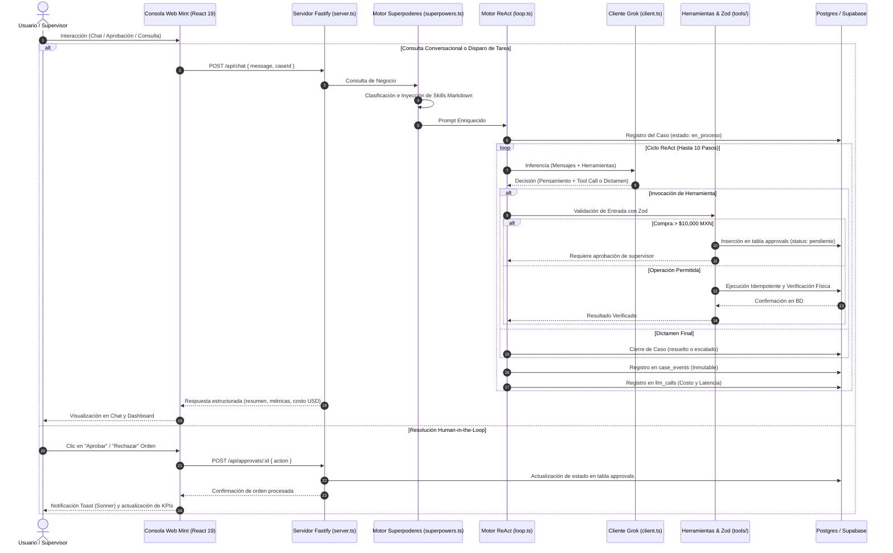

# Reporte Tecnico de Arquitectura e Implementacion

  

  <b>AI Back Office Agent (MINT) - Plataforma de Agente Autónomo para Operaciones de Back Office</b> 
  <i>Reto de Agentes Autónomos 2026 - Entrega Integral (Agente Fullstack End-to-End, Consola Web Mint y Human-in-the-Loop)</i>

---

## 1. Resumen Ejecutivo y Ficha Tecnica

El **AI Back Office Agent (MINT)** es una solución integral orientada a la coordinación de operaciones logísticas, control de inventarios, gestión de abastecimiento y supervisión presupuestaria corporativa.

La plataforma trasciende los modelos conversacionales tradicionales y los pipelines rígidos de automatización al combinar:
1. Un **bucle de razonamiento y acción ReAct** autónomo ejecutado sobre **xAI Grok (`grok-4.6`)**.
2. Un **motor de superpoderes** que inyecta dinámicamente conocimiento experto en Markdown según la naturaleza del problema.
3. Un arsenal de **8 herramientas de negocio tipadas** que interactúan con base de datos relacional mediante Drizzle ORM.
4. Una **consola web moderna (Mint Platform)** desarrollada en **React 19, Vite y Tailwind CSS v4** con panel de control, explorador de inventario, chat con el agente y bandeja de aprobaciones **Human-in-the-Loop**.
5. Persistencia dual: **PostgreSQL 16 en la nube (Supabase)** con triggers inmutables y contenedor local **Docker Compose**.

### Ficha Tecnica del Proyecto

| Parámetro | Especificación |
| :--- | :--- |
| **Nombre del Proyecto** | AI Back Office Agent (MINT) |
| **Repositorio Oficial** | [DMntill4/ai-back-office](https://github.com/DMntill4/ai-back-office) |
| **Versión / Hito** | v1.2.0 (Plataforma Fullstack con Consola Web Mint y Human-in-the-Loop) |
| **Dominio de Aplicación** | Coordinación Logística, Compras, Auditoría de Stock y Control Financiero |
| **Modelo Principal de IA** | xAI Grok (`grok-4.6`) mediante Gateway oficial de producción |
| **Consola Web (Frontend)** | React 19, TypeScript, Vite 6, Tailwind CSS v4, Framer Motion |
| **Servidor API Backend** | Fastify 5.x con soporte CORS y bus de eventos proactivos |
| **Base de Datos & ORM** | PostgreSQL 16 (Dual: Supabase Cloud con SSL + Docker Alpine local) con Drizzle ORM 0.45 |
| **Cobertura de Pruebas** | 20 de 20 pruebas automáticas en Vitest (100% pasando a costo $0 USD) |
| **Licencia** | ISC |

### Equipo Contribuidor

<table align="center">
  <tr>
    <td align="center" width="220px">
      <a href="https://github.com/DMntill4">
         
        <b>Diego Mantilla</b>
      </a> 
      <code>@DMntill4</code>
    </td>
    <td align="center" width="220px">
      <a href="https://github.com/andresguerra321">
         
        <b>Andres Guerra</b>
      </a> 
      <code>@andresguerra321</code>
    </td>
  </tr>
</table>

---

## 2. Épicas e Historias de Usuario

La arquitectura del sistema responde a seis épicas de desarrollo diseñadas para garantizar gobernanza, robustez técnica y facilidad operativa.

  

### Épica 1: Infraestructura Cloud y Auditoría Inmutable
* **Persistencia Cloud en Supabase:** PostgreSQL 16 alojado en la nube con soporte SSL automático en `src/db/client.ts`, operando 24/7 sin dependencia forzosa de contenedores locales.
* **Trazabilidad Inalterable:** Trigger nativo en PostgreSQL que rechaza modificaciones (`UPDATE`) y eliminaciones (`DELETE`) sobre la tabla de auditoría `case_events`.

### Épica 2: Conexión con Grok y Gobernanza de Costos
* **Gateway Unificado:** Conector centralizado en `src/llm/client.ts` con manejo de tiempos límite, reintentos exponenciales ante cuotas de API (`429` / `5xx`) y registro de métricas de costo en USD por cada inferencia en `llm_calls`.
* **Prueba de Humo y Autenticación:** Soporte flexible de llaves de entorno (`RETO_KEY`, `GROK_API_KEY`, `XAI_API_KEY`) verificado mediante pruebas continuas.

### Épica 3: Datos de Negocio y Arsenal de Herramientas
* **Catálogo Ampliado (16 SKUs):** Sembrado masivo con 5 productos sin stock, carencias de seguridad y alimentos perecederos con fecha de caducidad (criterio FEFO).
* **Arsenal de 8 Herramientas Tipadas en Zod:**
  1. `consultar_stock`: Búsqueda de inventario con Fuzzy Matching para tolerancia a errores tipográficos.
  2. `ver_ordenes_abiertas`: Detección de órdenes en camino y compras activas.
  3. `crear_orden_compra`: Creación idempotente con límite de aprobación humana ($10,000 MXN).
  4. `evaluar_proveedores`: Matriz comparativa de proveedores por costo, velocidad o balance general.
  5. `analisis_financiero`: Valuación de inventario total, compromisos financieros y presupuesto a 30 días.
  6. `simular_escenario`: Simulaciones What-If de demanda y contingencias por retrasos de proveedores.
  7. `auditar_anomalias`: Detección automática de descalces de inventario y sobrecostos.
  8. `generar_reporte_general`: Reportes ejecutivos de productos más vendidos, agotados, por reabastecer y por caducar.

### Épica 4: Bucle ReAct, Superpoderes y Pruebas a Costo Cero
* **Motor de Superpoderes:** Inyección dinámica de contexto y directivas expertas (`src/agent/skills/`) según la intención detectada en la consulta (financiera, crisis de stock, negociación, seguridad).
* **Validación a Costo $0 USD:** Cobertura de 20 pruebas automatizadas mediante un cliente simulado (`FakeGrokClient`) que reproduce casos complejos sin incurrir en costos de API.

### Épica 5: Consola Web Interactiva (Mint Platform) y Human-in-the-Loop Visual
* **Panel de Operaciones (Dashboard):** Visualización de KPIs en tiempo real (órdenes totales, tasa de automatización, revisiones pendientes, ahorros y gasto en USD) y gráficos interactivos de desempeño de proveedores (*Recharts*).
* **Bandeja de Aprobaciones Human-in-the-Loop:** Interfaz visual para que supervisores autoricen o rechacen órdenes de compra mayores a $10,000 MXN en un clic (`POST /api/approvals/:id`).
* **Consola de Chat del Agente:** Conversación fluida con sugerencias automáticas, insignias de estado de ejecución en vivo (`en_proceso`, `resuelto`, `escalado`) y desglose de tokens y costo en dólares.
* **Explorador de Inventario y Línea de Tiempo:** Vista tabular de productos y existencias (`StockView`) y registro cronológico de auditoría que sustituye la terminal tradicional.

### Épica 6: Entornos Reproducibles y Containerización con Docker
* **Despliegue Local Aislado:** `docker-compose.yml` que orquesta la base de datos `postgres:16-alpine` y el contenedor de la aplicación `node:20-alpine` (`Dockerfile`), con script de inicialización `docker/init-db.sql` con roles y extensiones (`pgcrypto`).

---

## 3. Arquitectura del Sistema y Flujo Fullstack

El diseño del sistema se rige bajo la premisa: **"El modelo decide qué hacer; el código valida, aplica permisos y verifica físicamente"**.

---

## 4. Stack Tecnológico e Infraestructura

| Capa Tecnológica | Herramienta / Librería | Función Principal |
| :--- | :--- | :--- |
| **Frontend UI** | React 19 + TypeScript + Vite 6 | Consola interactiva web de alto rendimiento y bajo consumo. |
| **Diseño y Estética** | Tailwind CSS v4 + Framer Motion | Interfaz Glassmorphism, tipografía Outfit y físicas fluidas. |
| **Componentes Visuales** | Lucide React + Recharts + Radix UI + cmdk | Gráficas analíticas, tooltips, paleta de comandos y notificaciones. |
| **Modelo de Inteligencia Artificial** | xAI Grok (`grok-4.6`) | Razonamiento de alto nivel, descomposición ReAct y toma de decisiones. |
| **Servidor HTTP / API** | Fastify 5.x + CORS | Endpoints REST de alto rendimiento para chat, dashboard y aprobaciones. |
| **Base de Datos Relacional** | PostgreSQL 16 (Supabase Cloud + Docker) | Persistencia ACID de negocio y tablas inmutables de auditoría. |
| **ORM & Migraciones** | Drizzle ORM 0.45 + Drizzle Kit | Mapeo relacional tipado en TypeScript y gestión de migraciones. |
| **Validación de Esquemas** | Zod 4.x | Validación en tiempo de ejecución de inputs de herramientas y config. |
| **Logging y Telemetría** | Pino + Pino-Pretty | Registros estructurados en formato JSON ultrarrápido. |
| **Contenedores** | Docker + Docker Compose + Alpine | Despliegue de desarrollo reproducible y aislado. |
| **Testing Automatizado** | Vitest 5.0 | Suite de 20 pruebas de unidad y escenarios simulados a costo $0 USD. |

---

## 5. Gobernanza, Seguridad Presupuestaria e Inmutabilidad

Para asegurar operaciones corporativas confiables, la plataforma implementa salvaguardas en cada nivel:

1. **Gobernanza Human-in-the-Loop Presupuestaria ($10,000 MXN):**
   - La herramienta `crear_orden_compra` calcula el monto total (`cantidad × precio_unitario`).
   - Si la orden supera los **$10,000 MXN**, el agente **nunca ejecuta la compra directamente**. En su lugar, emite un requerimiento en la tabla `approvals` con status `pendiente` y escala el caso para autorización en la interfaz web.
2. **Garantía de Idempotencia:**
   - Toda escritura exige una clave única de idempotencia (`idempotency_key`), previniendo transacciones duplicadas por caídas de red o reintentos de consulta.
3. **Verificación Física Post-Escritura:**
   - Un caso solo puede cerrarse como `resuelto` si el registro físico es verificado mediante una consulta de confirmación contra la base de datos relacional. Si la verificación falla, se clasifica como `escalado`.
4. **Trigger Append-Only en PostgreSQL:**
   - La tabla `case_events` cuenta con un trigger que rechaza sentencias `UPDATE` y `DELETE`, protegiendo la trazabilidad jurídica y corporativa.

---

## 6. Pruebas Técnicas y Escenarios Validados (Costo $0 USD)

Se dispone de una suite de **20 pruebas automatizadas** en `Vitest` organizadas en 8 archivos de test. Gracias al adaptador `FakeGrokClient`, los tests reproducen llamadas al modelo sin consumir saldo real de API:

| Archivo de Prueba | Escenarios Validados | Resultado |
| :--- | :--- | :---: |
| `tests/agent_schema.test.ts` | Validaciones de esquemas Zod de casos y eventos | ✅ Aprobado |
| `tests/agent_loop.test.ts` | Ciclo ReAct, resolución de casos y cierre estricto | ✅ Aprobado |
| `tests/tools.test.ts` | Herramientas de stock, órdenes y control de aprobación | ✅ Aprobado |
| `tests/scenarios.test.ts` | Escenarios de negocio complejos (reabastecimiento, desabasto, etc.) | ✅ Aprobado |
| `tests/db.test.ts` | Consultas relacionales y persistencia de auditoría | ✅ Aprobado |
| `tests/superpowers.test.ts` | Detección de intenciones e inyección de skills Markdown | ✅ Aprobado |
| `tests/proactive.test.ts` | Worker de auditoría proactiva y generación de alertas | ✅ Aprobado |
| `tests/idempotency.test.ts` | Prevención de duplicados en órdenes de compra concurrentes | ✅ Aprobado |

---

## 7. Telemetría y Control de Costos en USD

Cada llamada a Grok registra de forma estricta sus métricas en la tabla `llm_calls`:
- **Tarifa Base Grok 4.6:** $2.00 USD por millón de tokens de entrada / $10.00 USD por millón de tokens de salida / $0.50 USD por millón de tokens en caché.
- **Fórmula de Cálculo:**
  $$\text{Costo Total} = \left(\frac{\text{Tokens Prompt} \times 2.00}{10^6}\right) + \left(\frac{\text{Tokens Completion} \times 10.00}{10^6}\right)$$
- **Latencia:** Medición en milisegundos de cada turno del agente para auditoría de rendimiento.

---

  <b>AI Back Office Agent (MINT)</b> - Desarrollado por Diego Mantilla y Andres Guerra para el Reto de Agentes Autónomos 2026.

