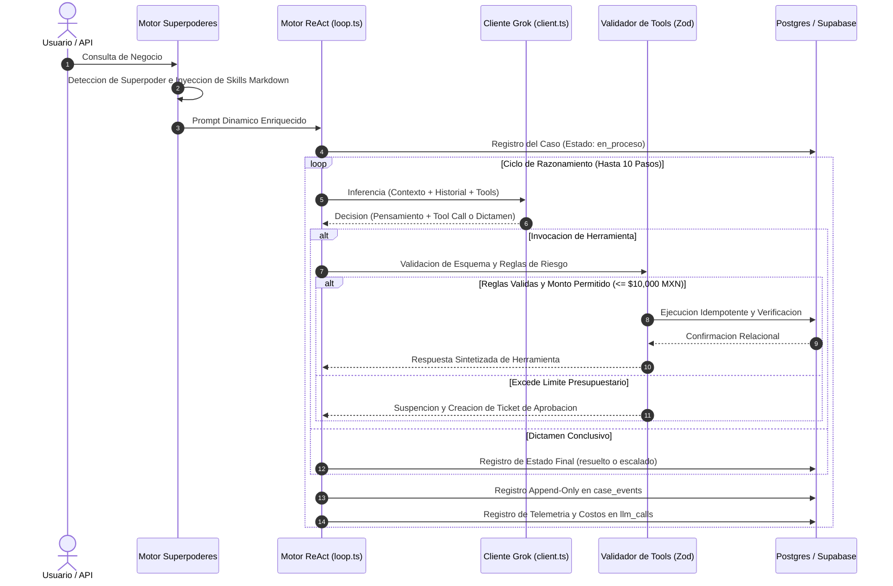

# Reporte Tecnico de Arquitectura e Implementacion

  

  <b>AI Back Office Agent - Agente Autonomo para Operaciones de Back Office</b> 
  <i>Reto de Agentes Autonomos 2026 - Entrega Semana 1 (Agente End-to-End)</i>

---

## 1. Resumen Ejecutivo y Ficha Tecnica

El **AI Back Office Agent** es una plataforma de agente autonomo orientada a la coordinacion de operaciones logisticas, control de inventarios y toma de decisiones de compras corporativas.

A diferencia de los asistentes conversacionales tradicionales o los flujos rigidos de automatizacion, el sistema implementa un **bucle autonomo de razonamiento y accion (ReAct)** impulsado por el modelo **xAI Grok (`grok-4.6`)**. La plataforma evalua activamente el estado de la cadena de suministro, orquesta multiples herramientas de negocio, calcula puntos de reabastecimiento (ROP/EOQ), evalua trade-offs de proveedores y valida fisicamente cada persistencia en PostgreSQL antes de cerrar o escalar un caso.

### Ficha Tecnica del Proyecto

| Parametro | Especificacion |
| :--- | :--- |
| **Nombre del Proyecto** | AI Back Office Agent (MINT) |
| **Repositorio Oficial** | [DMntill4/ai-back-office](https://github.com/DMntill4/ai-back-office) |
| **Version / Hito** | v1.1.0 (Agente Autonomo con Superpoderes y Persistencia Cloud) |
| **Dominio de Aplicacion** | Coordinacion Logistica, Compras, Auditoria y Control Financiero |
| **Modelo Principal de IA** | xAI Grok (`grok-4.6`) mediante Gateway de produccion |
| **Base de Datos** | PostgreSQL 16 (Soporte Dual: Local y Cloud Supabase con SSL) |
| **Licencia** | ISC |

### Equipo Contribuidor

<table align="center">
  <tr>
    <td align="center" width="200px">
      <a href="https://github.com/DMntill4">
         
        <b>Diego Mantilla</b>
      </a> 
      <code>@DMntill4</code>
    </td>
    <td align="center" width="200px">
      <a href="https://github.com/andresguerra321">
         
        <b>Andres Guerra</b>
      </a> 
      <code>@andresguerra321</code>
    </td>
  </tr>
</table>

---

## 2. Epicas e Historias de Usuario

La arquitectura del proyecto responde a cuatro epicas principales orientadas a garantizar robustez, gobernanza y eficiencia operativa.

  

### Epica 1: Infraestructura Cloud y Auditoria Inmutable
* **Persistencia Cloud en Supabase:** Servidor PostgreSQL 16 en la nube con soporte SSL automatico, operando 24/7 sin dependencia forzosa de contenedores locales.
* **Trazabilidad Inalterable:** Trigger nativo en PostgreSQL que rechaza modificaciones (`UPDATE`) y eliminaciones (`DELETE`) sobre la tabla de eventos de auditoria `case_events`.

### Epica 2: Conexion con Grok y Gobernanza de Costos
* **Gateway Unificado:** Conector centralizado en `src/llm/client.ts` con manejo de tiempos limite, reintentos exponenciales ante cuotas de API (`429` / `5xx`) y registro de metricas de costo en USD por cada inferencia.
* **Prueba de Humo y Autenticacion:** Soporte flexible de llaves de entorno (`RETO_KEY`, `GROK_API_KEY`, `XAI_API_KEY`) verificado mediante pruebas continuas.

### Epica 3: Datos de Negocio y Herramientas Especializadas
* **Catalogo Ampliado:** Sembrado masivo de 16 SKUs industriales y comerciales con 5 productos sin stock, carencias de seguridad y alimentos proximos a vencer (metodologia FEFO).
* **Arsenal de Herramientas Tipadas:** Invocacion de `consultar_stock`, `ver_ordenes_abiertas`, `crear_orden_compra`, `evaluar_proveedores`, `analisis_financiero`, `simular_escenario` y `auditar_anomalias` con validacion estricta en Zod.

### Epica 4: Bucle ReAct, Superpoderes y Pruebas a Costo Cero
* **Motor de Superpoderes:** Inyeccion dinamica de contexto y skills en Markdown (`src/agent/skills/`) segun la naturaleza de la consulta (financiera, crisis de stock, negociacion o reportes ejecutivos).
* **Validacion a Costo $0 USD:** Cobertura de 20 pruebas automatizadas mediante un cliente simulado (`FakeGrokClient`) que valida escenarios complejos sin incurrir en costos de API.

---

## 3. Arquitectura del Sistema y Flujo de Control ReAct

El diseno sigue el principio fundamental: **"El modelo decide que hacer; el codigo valida, aplica permisos y verifica"**. El LLM opera como un motor de razonamiento que propone acciones, mientras que la plataforma en TypeScript aplica las reglas de negocio y seguridad.

---

## 4. Stack Tecnologico e Infraestructura

| Capa Tecnologica | Herramienta / Libreria | Funcion Principal |
| :--- | :--- | :--- |
| **Modelo de Lenguaje** | xAI Grok (`grok-4.6`) | Inferencia de alto nivel y toma autonoma de decisiones. |
| **Lenguaje y Entorno** | TypeScript 5.6 + Node.js (LTS) | Entorno de desarrollo con tipado estatico estricto. |
| **Base de Datos Relacional** | PostgreSQL 16 (Supabase Cloud + Docker) | Persistencia de datos operacionales y auditoria relacional. |
| **Mapeo Relacional** | Drizzle ORM 0.45 + Drizzle Kit | Definicion de esquemas en TypeScript y control de migraciones. |
| **Servidor HTTP / API** | Fastify 5.x + Cors | Endpoints REST de chat y motor de alertas proactivas. |
| **Validacion de Esquemas** | Zod 4.x | Validacion en tiempo de ejecucion de entradas, salidas y configuracion. |
| **Logging Estructurado** | Pino + Pino-Pretty | Generacion de registros JSON estructurados de alta velocidad. |
| **Framework de Pruebas** | Vitest 5.0 | Ejecucion ultrarrapida de pruebas de unidad y escenarios simulados. |

---

## 5. Gobernanza, Seguridad Presupuestaria e Inmutabilidad

Para garantizar que el agente opere de forma segura en entornos corporativos, se implementaron controles estrictos a nivel de codigo y base de datos:

1. **Limite de Aprobacion Presupuestaria ($10,000 MXN):**
   - La herramienta `crear_orden_compra` calcula automaticamente el monto total de cada transaccion (`cantidad × precio_unitario`).
   - Si la orden supera los **$10,000 MXN**, el sistema suspende la compra directa y genera un registro formal en la tabla `approvals` con status `pendiente` para revision humana obligatoria.

2. **Garantia de Idempotencia:**
   - Cada accion de escritura requiere una clave unica de idempotencia (`idempotency_key`), previniendo compras duplicadas ante reintentos de red.

3. **Verificacion Post-Escritura:**
   - Un caso no se marca como `resuelto` unicamente por afirmacion del modelo; el sistema comprueba la persistencia efectiva de los registros en la base de datos relacional.

4. **Auditoria Inmutable en PostgreSQL:**
   - La tabla `case_events` cuenta con un trigger nativo que bloquea sentencias `UPDATE` y `DELETE`, protegiendo el historial de auditoria corporativa.

---

## 6. Pruebas Tecnicas y Escenarios Validados (Costo $0 USD)

Se dispone de una suite de **20 pruebas automatizadas** ejecutadas con `Vitest`. Mediante la abstraccion `FakeGrokClient`, la suite reproduce las respuestas del modelo sin consumir saldo de la API.

### Principales Escenarios de Negocio Validados

| Escenario de Prueba | Situacion Evaluada | Resultado y Solucion Aplicada |
| :--- | :--- | :--- |
| **Reposicion de Stock Exitosa** | Faltante de inventario detectado con proveedor disponible y monto dentro del limite. | El agente consulta stock, selecciona proveedor, emite orden de compra idempotente, verifica en disco y cierra como `resuelto`. |
| **Desabasto sin Proveedores** | Producto con stock cero donde ningun proveedor tiene capacidad de entrega inmediata. | El agente identifica la falta de alternativas viables y escala el caso a supervision humana con la evidencia recopilada. |
| **Exceso de Limite Presupuestario** | Solicitud de compra que excede el tope de $10,000 MXN. | La herramienta detiene la insercion, notifica requerimiento de aprobacion y el agente escala el caso a un supervisor. |
| **Prevencion de Duplicados** | Intento de re-ejecucion de una orden de compra previamente procesada. | La clave de idempotencia detecta la transaccion previa y retorna el registro existente sin generar duplicados. |

---

## 7. Telemetria y Control Financiero

Cada interaccion con el modelo de IA registra de forma transparente su impacto en latencia y costo financiero.

* **Formula de Costo:** `Costo Total = (Tokens Entrada x $2.00 / 1M) + (Tokens Salida x $10.00 / 1M) + (Tokens Cache x $0.50 / 1M)`.
* **Registro por Llamada:** La tabla `llm_calls` almacena el tiempo de respuesta en milisegundos, el desglose de tokens y el costo en USD con precision decimal.

---

  <b>AI Back Office Agent</b> - Proyecto desarrollado por Diego Mantilla y Andres Guerra para el Reto de Agentes Autonomos 2026.

