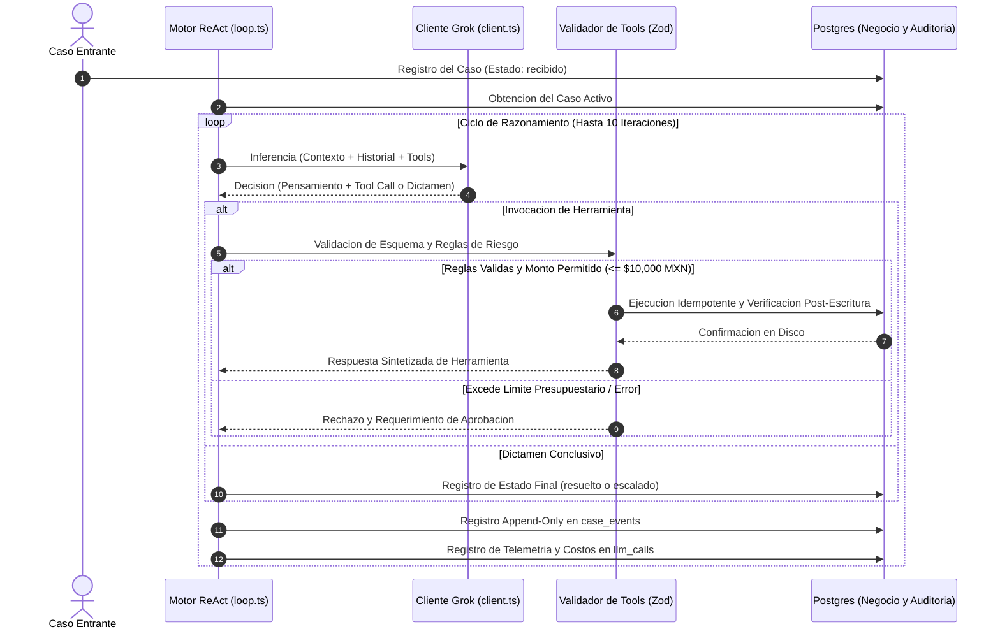
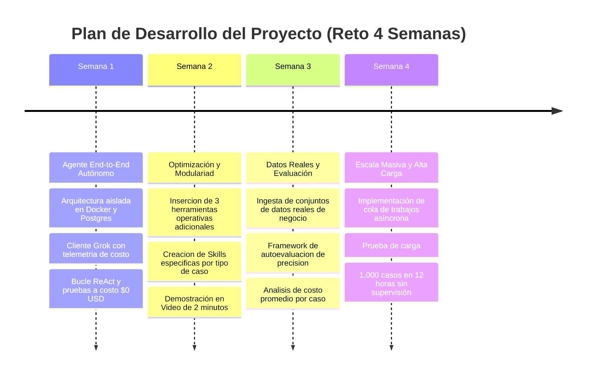

# Reporte Técnico de Arquitectura e Implementación

  

  <b>AI Back Office Agent — Agente Autónomo para Operaciones de Back Office</b> 
  <i>Reto de Agentes Autónomos 2026 • Entrega Semana 1 (Agente End-to-End)</i>

---

## 1. Resumen Ejecutivo y Ficha Técnica

El **AI Back Office Agent** es una plataforma de agente autónomo diseñada para resolver incidencias operativas de back office, tales como faltantes de stock, evaluación de proveedores y gestión de órdenes de compra.

A diferencia de los asistentes conversacionales tradicionales o los flujos rígidos tipo workflow (n8n/low-code), el sistema implementa un **bucle autónomo de razonamiento y acción (ReAct)** impulsado por el modelo **xAI Grok (`grok-4.6`)**. El sistema evalúa el estado del negocio, determina las herramientas requeridas, valida los límites de riesgo en código y comprueba físicamente cada cambio en la base de datos PostgreSQL antes de cerrar un caso.

### Ficha Técnica del Proyecto

| Parámetro | Especificación |
| :--- | :--- |
| **Nombre del Proyecto** | AI Back Office Agent |
| **Repositorio Oficial** | [DMntill4/ai-back-office](https://github.com/DMntill4/ai-back-office) |
| **Versión / Hito** | v1.0.0 (Semana 1: Agente End-to-End Autónomo) |
| **Dominio de Aplicación** | Gestión de Inventario, Compras, Auditoría y Abastecimiento |
| **Modelo Principal de IA** | xAI Grok (`grok-4.6`) mediante Gateway de producción |
| **Licencia** | ISC |

### Equipo Contribuidor

<table align="center">
  <tr>
    <td align="center" width="200px">
      <a href="https://github.com/DMntill4">
         
        <b>Diego Mantilla</b>
      </a> 
      <code>@DMntill4</code>
    </td>
    <td align="center" width="200px">
      <a href="https://github.com/andresguerra321">
         
        <b>Andrés Guerra</b>
      </a> 
      <code>@andresguerra321</code>
    </td>
  </tr>
</table>

---

## 2. Épicas e Historias de Usuario

La arquitectura del proyecto responde a cuatro épicas principales orientadas a garantizar robustez, gobernanza y eficiencia operativa.

  

### Épica 1: Infraestructura y Auditoría Inmutable
* **Despliegue Aislado:** Base de datos PostgreSQL 16 aislada en contenedor Docker con esquemas relacionales administrados por Drizzle ORM.
* **Trazabilidad Inalterable:** Trigger nativo en PostgreSQL que prohíbe modificaciones (`UPDATE`) o eliminaciones (`DELETE`) sobre la tabla de eventos de auditoría `case_events`.

### Épica 2: Conexión con Grok y Gobernanza de Costos
* **Gateway Unificado:** Conexión centralizada en `src/llm/client.ts` con manejo de tiempos límite, reintentos exponenciales ante cuotas de API (`429` / `5xx`) y registro de métricas de costo en USD por cada inferencia.
* **Prueba de Humo:** Verificación del canal de comunicación y capacidades del gateway mediante `npm run smoke`.

### Épica 3: Datos de Negocio y Herramientas Operativas
* **Servicios de Negocio:** Capa de abstracción relacional para catálogo de productos, inventario, historial de ventas y directorio de proveedores.
* **Herramientas Tipadas:** Ejecución de acciones de lectura (`consultar_stock`, `ver_ordenes_abiertas`) y escritura (`crear_orden_compra`) validadas con esquemas estrictos de Zod.

### Épica 4: Bucle ReAct y Pruebas a Costo Cero
* **Motor Autónomo:** Algoritmo ReAct en `src/agent/loop.ts` capaz de investigar, invocar herramientas secuenciales y emitir un dictamen final de caso (`resuelto` o `escalado`).
* **Validación a Costo $0 USD:** Cobertura de pruebas automatizadas mediante un cliente simulado (`FakeGrokClient`) que valida escenarios complejos sin incurrir en costos de API.

---

## 3. Arquitectura del Sistema y Flujo de Control ReAct

El diseño sigue el principio fundamental: **"El modelo decide qué hacer; el código valida, aplica permisos y verifica"**. El LLM opera como un motor de razonamiento que propone acciones, mientras que la plataforma en TypeScript aplica las reglas de negocio y seguridad.

---

## 4. Stack Tecnológico e Infraestructura

| Capa Tecnológica | Herramienta / Librería | Función Principal |
| :--- | :--- | :--- |
| **Modelo de Lenguaje** | xAI Grok (`grok-4.6`) | Inferencia de alto nivel y toma autonoma de decisiones. |
| **Lenguaje y Entorno** | TypeScript 5.6 + Node.js (LTS) | Entorno de desarrollo con tipado estatico estricto. |
| **Base de Datos Relacional** | PostgreSQL 16 (Docker) | Persistencia de datos operacionales y auditoria relacional. |
| **Mapeo Relacional** | Drizzle ORM 0.45 + Drizzle Kit | Definicion de esquemas en TypeScript y control de migraciones. |
| **Validacion de Esquemas** | Zod 4.x | Validacion en tiempo de ejecucion de entradas, salidas y configuracion. |
| **Logging Estructurado** | Pino + Pino-Pretty | Generacion de registros JSON estructurados de alta velocidad. |
| **Framework de Pruebas** | Vitest 5.0 | Ejecucion ultrarrapida de pruebas de unidad y escenarios simulados. |

---

## 5. Gobernanza, Seguridad Presupuestaria e Inmutabilidad

Para garantizar que el agente opere de forma segura en entornos corporativos, se implementaron controles estrictos a nivel de código y base de datos:

1. **Límite de Aprobación Presupuestaria ($10,000 MXN):**
   * La herramienta `crear_orden_compra` calcula automáticamente el monto total de cada transacción (`cantidad × precio_unitario`).
   * Si la orden supera los **$10,000 MXN**, el código detiene la transacción, impide la escritura en base de datos y marca la acción como "requiere aprobación humana", provocando el escalamiento del caso.

2. **Garantía de Idempotencia:**
   * Cada acción de escritura requiere una clave única de idempotencia (`idempotency_key`). Esto previene la duplicación de órdenes de compra en caso de reintentos de red o repeticiones del modelo.

3. **Verificación Post-Escritura:**
   * Un caso no se marca como `resuelto` únicamente porque el modelo lo indique. El sistema realiza una re-consulta a la base de datos para verificar que el registro fue persistido correctamente en disco.

4. **Auditoría Inmutable en PostgreSQL:**
   * La tabla `case_events` cuenta con un trigger que bloquea sentencias `UPDATE` y `DELETE`. Todo pensamiento, decisión y resultado se almacena de forma inalterable para revisiones posteriores.

---

## 6. Pruebas Técnicas y Escenarios Validados (Costo $0 USD)

Se diseñó una suite de **20 pruebas automatizadas** ejecutadas con `Vitest`. Mediante la abstracción `FakeGrokClient`, la suite reproduce las respuestas del modelo sin consumir saldo de la API.

### Principales Escenarios de Negocio Validados

| Escenario de Prueba | Situación Evaluada | Resultado y Solución Aplicada |
| :--- | :--- | :--- |
| **Reposición de Stock Exitosa** | Faltante de inventario detectado con proveedor disponible y monto dentro del límite. | El agente consulta stock, selecciona proveedor, emite orden de compra idempotente, verifica en disco y cierra como `resuelto`. |
| **Desabasto sin Proveedores** | Producto con stock cero donde ningún proveedor tiene capacidad de entrega inmediata. | El agente identifica la falta de alternativas viables y escala el caso a supervisión humana con la evidencia recopilada. |
| **Exceso de Límite Presupuestario** | Solicitud de compra que excede el tope de $10,000 MXN. | La herramienta detiene la inserción, notifica requerimiento de aprobación y el agente escala el caso a un supervisor. |
| **Prevención de Duplicados** | Intento de re-ejecución de una orden de compra previamente procesada. | La clave de idempotencia detecta la transacción previa y retorna el registro existente sin generar duplicados. |

---

## 7. Telemetría y Control Financiero

Cada interacción con el modelo de IA registra de forma transparente su impacto en latencia y costo financiero.

* **Fórmula de Costo:** `Costo Total = (Tokens Entrada × $2.00 / 1M) + (Tokens Salida × $10.00 / 1M) + (Tokens Caché × $0.50 / 1M)`.
* **Registro por Llamada:** La tabla `llm_calls` almacena el tiempo de respuesta en milisegundos, el desglose de tokens y el costo en USD con precisión decimal.

---

## 8. Hoja de Ruta y Visión Futura

---

  <b>AI Back Office Agent</b> • Proyecto desarrollado por Diego Mantilla y Andrés Guerra para el Reto de Agentes Autónomos 2026.

