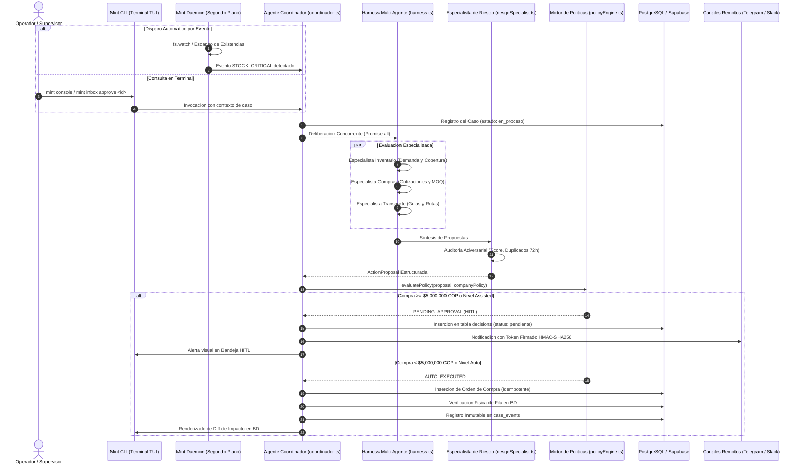

# [ARQUITECTURA] Reporte Tecnico de Arquitectura e Implementacion

  

  <b>AI Back Office Agent (MINT) - Plataforma de Coordinacion Logistica Autonoma Multi-Agente</b> 
  <i>Reto de Agentes Autonomos 2026 - Arquitectura 100% Terminal-First, Gobernanza Determinista y Multi-Agente en Paralelo</i>

---

## 1. Resumen Ejecutivo y Ficha Tecnica

El **AI Back Office Agent (MINT)** es una solucion autonoma orientada a la coordinacion de operaciones logisticas, control de inventarios, gestion de abastecimiento y supervision presupuestaria en empresas de distribucion de suministros industriales.

El sistema trasciende los asistentes conversacionales basicos al incorporar:
1. Una **arquitectura 100% Terminal-First** operada a traves de **Mint CLI** y supervisada en segundo plano por **Mint Daemon**, eliminando la necesidad de frameworks web o servidores HTTP locales.
2. Un **Harness Multi-Agente Concurrente** con cuatro especialistas dedicados (Inventario, Compras, Transporte y Riesgo) que deliberan en paralelo mediante ejecucion asincrona.
3. Un **Motor de Politicas Determinista** (`evaluatePolicy`) en codigo matematico que audita el umbral de gasto ($5,000,000 COP), previene duplicidad en 72 horas y aplica guardrails inviolables.
4. Un arsenal de **herramientas de negocio fuertemente tipadas en Zod** que interactuan de forma segura e idempotente con PostgreSQL mediante Drizzle ORM.
5. Una interfaz de terminal profesional (TUI) con arbol de introspeccion (**Thought Tree**) y tarjetas tecnicas de **Diff de Impacto en Base de Datos**.
6. Un **Data Layer blindado** con circuit breaker ante borrados masivos (>20%), confirmacion en dos fases, deteccion de alteracion de esquema (schema drift) y rechazo de datos obsoletos (`RULE_STALE_DATA_REFUSAL`).
7. Gobernanza remota multicanal a traves de **Telegram**, **Slack** y **Gmail** con tokens criptograficos firmados HMAC-SHA256 de un solo uso.

### Ficha Tecnica del Proyecto

| Parametro | Especificacion |
| :--- | :--- |
| **Nombre del Proyecto** | AI Back Office Agent (MINT) & Mint CLI |
| **Repositorio Oficial** | [DMntill4/ai-back-office](https://github.com/DMntill4/ai-back-office) |
| **Rama Activa** | `developGuerra` |
| **Arquitectura** | Monorepo modular con npm workspaces (100% Terminal-First) |
| **Dominio de Negocio** | Ferreteria y Suministros Industriales (`Ferreteria Industrial Santandereana S.A.S.`) |
| **Sedes Operativas** | Bucaramanga (`BOD-BUC`), Bogota (`BOD-BOG`), Medellin (`BOD-MED`) |
| **Moneda y Umbral** | Pesos Colombianos (COP) / Umbral HITL: $5,000,000 COP |
| **Modelo Principal de IA** | xAI Grok (`grok-4.6`) mediante Gateway oficial de produccion |
| **Base de Datos & ORM** | PostgreSQL 16 (Supabase Cloud + Docker Alpine) + Drizzle ORM 0.45 |
| **Cobertura de Pruebas** | 82 de 82 pruebas automatizadas en Vitest (23 suites de prueba) |
| **Licencia** | ISC |

---

## 2. Diagrama de Secuencia y Flujo Operativo

El diseno del sistema se rige bajo el principio: **"El modelo de IA propone; el codigo determinista valida, audita el riesgo y ejecuta con verificacion fisica"**.

---

## 3. Stack Tecnologico e Infraestructura

| Capa Tecnologica | Herramienta / Libreria | Funcion Principal |
| :--- | :--- | :--- |
| **Entorno de Ejecucion** | Node.js (>=22.5.0) | Motor de ejecucion con soporte nativo de `node:sqlite`. |
| **Lenguaje y Tipado** | TypeScript 5.6 | Tipado estricto end-to-end con cero errores en compilacion. |
| **Monorepo** | npm workspaces | Modularizacion en `@mint/core`, `@mint/cli`, `@mint/daemon`, `@mint/ingest`, `@mint/notifiers`. |
| **Terminal TUI** | Chalk + Cli-Table3 + Ora | Interfaz de terminal de alta densidad inspirada en Claude Code / Kali Linux. |
| **Inteligencia Artificial** | xAI Grok (`grok-4.6`) | Inferencia de razonamiento y generacion de planes ReAct. |
| **Base de Datos Relacional** | PostgreSQL 16 (Supabase + Docker) | Persistencia transaccional ACID y triggers inmutables de auditoria. |
| **ORM & Migraciones** | Drizzle ORM 0.45 + Drizzle Kit | Acceso a datos tipado y gestion controlada de esquemas. |
| **Validacion de Esquemas** | Zod 4.x | Validacion en runtime de parametros de tools y configuraciones. |
| **Seguridad de Credenciales** | Crypto Nativo (AES-256-GCM / Scrypt) | Boveda cifrada local (`keychain.ts`) sin almacenamiento en texto plano. |
| **Gobernanza Remota** | Telegram Bot API + Slack Bolt + Nodemailer | Aprobaciones HITL remotas mediante firmas criptograficas HMAC-SHA256. |
| **Testing Automatizado** | Vitest 5.0 | 82 pruebas automatizadas sin consumo de API gracias a `FakeGrokClient`. |

---

## 4. Gobernanza Determinista, Seguridad Presupuestaria e Inmutabilidad

Para garantizar estabilidad corporativa y eliminar riesgos de alucinacion, la plataforma implementa:

1. **Gobernanza Human-in-the-Loop Presupuestaria ($5,000,000 COP):**
   - El costo total es calculado matematicamente por codigo determinista (`cantidad × precio_unitario`).
   - Si la compra es igual o superior a **$5,000,000 COP**, el agente **nunca ejecuta la compra directamente**. En su lugar, emite una propuesta estructurada en la tabla `decisions` y escala el caso para autorizacion humana.
2. **Garantia de Idempotencia y Ventana Anti-Duplicados (72 Horas):**
   - Toda transaccion requiere una clave unica (`idempotencyKey`).
   - El motor de politicas bloquea compras si ya existe una orden activa para el mismo producto con el mismo proveedor dentro de 72 horas.
3. **Verificacion Fisica Post-Escritura:**
   - Un caso solo puede cerrarse como `resuelto` si la fila insertada es verificada fisicamente mediante una consulta de confirmacion contra PostgreSQL.
4. **Trigger Append-Only en PostgreSQL:**
   - La tabla `case_events` cuenta con un trigger nativo (`trigger_prevent_case_events_delete`) que deniega terminantemente sentencias `UPDATE` y `DELETE`.
5. **Circuit Breaker y Guardrail de Frescura:**
   - Si una sincronizacion pierde mas del 20% de los productos activos, el motor congela la actualizacion.
   - Si los datos superan 24 horas sin sincronizarse, el sistema activa `RULE_STALE_DATA_REFUSAL` y rechaza autoejecutar ordenes.

---

## 5. Resumen de Pruebas Tecnicas Automatizadas

La suite cuenta con **82 pruebas automatizadas** en `Vitest` (100% pasando):

| Archivo de Prueba | Escenarios Validados | Estado |
| :--- | :--- | :---: |
| `tests/immutability.test.ts` | Triggers PostgreSQL append-only y bloqueo de DELETE | [OK] |
| `tests/tools.test.ts` | Herramientas de stock, ordenes de compra y esquemas Zod | [OK] |
| `tests/cli_keychain.test.ts` | Cifrado AES-256-GCM y derivacion scrypt de credenciales | [OK] |
| `tests/policy_engine.test.ts` | Reglas deterministas, umbrales y modos de autonomia | [OK] |
| `tests/auth_setup.test.ts` | Flujo de configuracion inicial y provision de empresas | [OK] |
| `tests/context_manager.test.ts` | Manejo de memoria operativa y contexto multi-turno | [OK] |
| `tests/llm_client.test.ts` | Conector de xAI Grok, manejo de cuotas y reintentos | [OK] |
| `tests/config.test.ts` | Validacion de variables de entorno y defaults seguros | [OK] |
| `tests/sales_channel_execution.test.ts` | Procesamiento idempotente de ventas por canales | [OK] |
| `tests/agent_schema.test.ts` | Validaciones estrictas de esquemas de datos del agente | [OK] |
| `tests/demand_and_shipments.test.ts` | Calculo de consumo historico y seguimiento de guias | [OK] |
| `tests/ingest.test.ts` | Ingesta tolerante a fallos y mapeo semantico de columnas | [OK] |
| `tests/benchmark_agent_vs_baseline.test.ts` | Evaluacion cuantitativa del agente vs politica basica | [OK] |
| `tests/agent_loop.test.ts` | Ciclo ReAct, ejecucion de tools y dictamen final | [OK] |
| `tests/autonomous_harness_and_team.test.ts` | Deliberacion concurrente y roles RBAC SaaS | [OK] |
| `tests/cli_terminal_autonomous.test.ts` | Comandos de terminal, Thought Tree y UI visual | [OK] |
| `tests/telegram_remote_approval.test.ts` | Aprobacion remota con tokens firmados HMAC-SHA256 | [OK] |
| `tests/scenarios.test.ts` | Choques de suministro what-if en sandbox | [OK] |
| `tests/e2e_mint_cli.test.ts` | Flujo de vida completo end-to-end de Mint CLI | [OK] |
| `tests/daemon_watcher.test.ts` | Observador de archivos fs.watch y monitor periodico | [OK] |
| `tests/data_layer_hardening.test.ts` | Circuit breaker (>20%), drift y frescura de datos | [OK] |

---

## 6. Telemetria y Control de Costos

Cada llamada a Grok registra de forma estricta sus metricas en la tabla `llm_calls`:
- **Tarifa Base Grok 4.6:** $2.00 USD por millon de tokens de entrada / $10.00 USD por millon de tokens de salida.
- **Auditoria de Eficiencia:** El Harness Multi-Agente ejecuta llamadas concurrentes compactas con prompts delimitados por especialista, reduciendo la ventana de contexto y los costos operativos en comparacion con un agente monolítico.

---

  <b>AI Back Office Agent (MINT)</b> - Desarrollado para el Reto de Agentes Autonomos 2026.

