# [ARQUITECTURA] Reporte Técnico de Arquitectura — Season 2 (MINT)

<p align="center">
  
</p>

<p align="center">
  <b>MINT — Autonomous AI Back-Office Agent (Season 2)</b><br>
  <i>Plataforma de Coordinación Logística, Compras y Gobernanza de Back-Office 100% Terminal-First</i><br>
  <b>Reto de Agentes Autónomos 2026 — Edición Season 2</b>
</p>

---

## 1. Resumen Ejecutivo y Ficha Técnica de Season 2

La **Season 2 (S2)** de **MINT** marca la transición definitiva de un prototipo experimental con dependencias web y plantillas sintéticas hacia un **Agente Autónomo de Back-Office de Grado Industrial**, diseñado bajo una arquitectura **100% Terminal-First**, distribuida, determinista y auditada matemáticamente.

En esta iteración, el sistema erradica por completo el código duplicado ("síndrome del espejo"), elimina las alucinaciones numéricas sustituyéndolas por análisis cuantitativo sobre bases de datos relacionales, endurece la capa de datos con circuit breakers y validación en dos fases, e introduce una interfaz de terminal profesional de alta densidad (TUI) con árboles de deliberación en tiempo real y tarjetas de auditoría de impacto físico en base de datos.

### Ficha Técnica de Season 2

| Parámetro | Especificación Season 2 |
| :--- | :--- |
| **Nombre del Sistema** | MINT — Autonomous AI Back-Office Agent (Season 2) |
| **Repositorio Oficial** | [DMntill4/ai-back-office](https://github.com/DMntill4/ai-back-office) |
| **Rama de Producción** | `developGuerra` |
| **Paradigma Operativo** | **100% Terminal-First** (Operado vía Mint CLI y vigilado por Mint Daemon) |
| **Modularidad** | Monorepo modular desacoplado con **npm workspaces** (5 paquetes) |
| **Dominio Calibrado** | Suministros Industriales y Ferretería (*Ferretería Industrial Santandereana S.A.S.*) |
| **Sedes Operativas** | Bucaramanga (`BOD-BUC`), Bogotá (`BOD-BOG`) y Medellín (`BOD-MED`) |
| **Moneda y Umbrales** | Pesos Colombianos (COP) / Umbral HITL Autónomo: **$5,000,000 COP** |
| **Motor de Razonamiento (LLM)** | xAI Grok (`grok-4.6`) con gateway de reintentos, fallback y telemetría |
| **Motor de Testing** | `FakeGrokClient` para pruebas deterministas sin costo de API ($0 USD en CI) |
| **Base de Datos & ORM** | PostgreSQL 16 (Supabase Cloud + Docker local) + Drizzle ORM 0.45 |
| **Conectores Portables** | `node:sqlite` nativo (solo lectura), Postgres transaccional y Excel |
| **Gobernanza Criptográfica** | Firmas HMAC-SHA256 de un solo uso con protección anti-replay |
| **Seguridad de Terminal** | Bóveda local cifrada con **AES-256-GCM** y derivación `scrypt` (`keychain.ts`) |
| **Cobertura de Pruebas** | **82 de 82 pruebas automatizadas en Vitest** (23 suites de prueba al 100%) |

---

## 2. Matriz Comparativa: Season 1 vs Season 2

A continuación se documentan las deficiencias identificadas en la versión preliminar (S1) y las soluciones de ingeniería implementadas en Season 2:

| Área de Arquitectura | Estado en Season 1 (Preliminar) | Estado en Season 2 (Producción) |
| :--- | :--- | :--- |
| **Estructura del Código** | "Síndrome del espejo": carpeta duplicada `/src` en raíz idéntica byte a byte a `packages/core/src`. Cambios no se reflejaban. | **Erradicación total de `/src` raíz.** Consolidación en npm workspaces con `@mint/core`, `@mint/cli`, `@mint/daemon`, `@mint/ingest` y `@mint/notifiers`. |
| **Paradigma de Ejecución** | Dependencia obligatoria de servidor Fastify (puerto 3001) y frontend React web para operar. | **100% Terminal-First.** Operación completa desde consola Unix profesional (`mint start`, `mint console`, `mint inbox`, etc.). |
| **Análisis de Metas Financieras** | Plantillas con porcentajes fijos ficticios (40%, 25%, 20%, 15%), costo unitario inventado (380) y gasto sustituido artificialmente por 185,000. | **Motor Cuantitativo Real (`goalSeekingService.ts`).** Cálculos analíticos sobre transacciones reales de órdenes de compra, cobertura real de stock e historial en Postgres. |
| **Comportamiento del Agente** | Agente más discursivo que operativo. Textos de marketing pregrabados en consola sobre "especialistas criptográficos". | **Harness Multi-Agente Concurrente (`harness.ts`).** 4 especialistas reales (Inventario, Compras, Transporte y Riesgo) deliberando en paralelo. |
| **Manejo de Errores en BD** | Bloques `catch {}` vacíos que ocultaban caídas de BD y continuaban con datos en blanco. | **Manejo estricto de excepciones**, circuit breakers, trazabilidad de logs estructurados y verificación física de filas. |
| **Dominio y Moneda** | Datos descontextualizados en pesos mexicanos ($10,000 MXN), catálogo de renta de autos (`opus-rentals`). | **Dominio Industrial Colombiano (COP).** Catálogo ferretero real, sedes Bucaramanga/Bogotá/Medellín y umbral de $5,000,000 COP. |
| **Protección del Data Layer** | Sincronizaciones destructivas sin verificación; borrado de datos ante CSVs incompletos. | **Circuit Breaker (>20% de pérdida), confirmación de borrado en dos fases** y guardrail determinista de frescura (`RULE_STALE_DATA_REFUSAL`). |
| **Interfaz de Usuario (CLI)** | Presencia excesiva de emojis, saturación visual y bugs de paginación en `/inbox` que rompían el scroll de la terminal. | **Estética Linux TUI sobria (estilo Claude Code/Kali),** sin emojis, con Thought Tree interactivo y renderizado acotado en `/inbox`. |
| **Auditoría de Acciones** | Mensajes de texto plano sin confirmación en base de datos. | **Tarjetas de Diff de Impacto en BD (`renderProductionAuditCard`),** verificación de cambios estado previo vs nuevo y trigger append-only. |

---

## 3. Arquitectura del Sistema Season 2

El sistema está organizado como un Monorepo modular de alta cohesión y bajo acoplamiento:

```text
ai-back-office/
├── packages/
│   ├── core/           # Cerebro Autónomo: Agentes, Harness, Zod Tools, Drizzle DB, Políticas y Servicios
│   ├── cli/            # Interfaz TUI Profesional: Comandos, Thought Tree, Diff Cards, Keychain AES-256
│   ├── daemon/         # Proceso de Fondo: fs.watch, triggers de stock bajo y retrasos, switch de pausa
│   ├── ingest/         # Ingesta Asistida: Mapeo semántico, Circuit Breaker (>20%), Drift Detection, SQLite/Excel
│   └── notifiers/      # Canales Remotos: Telegram Bot API, Slack Block Kit, Gmail SMTP con firmas HMAC
├── config/             # Variables de entorno y plantillas de configuración
├── docker/             # Docker Compose para PostgreSQL 16 y extensiones
├── docs/               # Documentación Técnica, Reportes de Arquitectura y ADRs
├── scripts/            # Scripts de soporte, mantenimiento y semillas
└── tests/              # 82 pruebas automatizadas en Vitest (23 suites completas)
```

### Componentes Principales

#### 1. `@mint/core` (Núcleo de Inteligencia y Gobernanza)
- **Harness Multi-Agente Concurrente (`packages/core/src/agent/harness.ts`):** Orquestación paralela con `Promise.all` de los cuatro roles operativos:
  - `inventarioSpecialist.ts`: Cálculo de consumo medio diario, días de inventario y detección matemática de quiebre.
  - `comprasSpecialist.ts`: Evaluación de proveedores homologados, cotizaciones en COP, MOQ (Minimum Order Quantity) y SLA.
  - `transporteSpecialist.ts`: Auditoría de guías en tránsito, cálculo de retrasos y replanificación de rutas logísticas.
  - `riesgoSpecialist.ts`: Agente adversarial ("Abogado del Diablo") que audita duplicidad en 72h, riesgo del proveedor y sobrecostos.
- **Motor de Políticas Determinista (`packages/core/src/agent/policyEngine.ts`):** Código 100% determinista que aplica reglas matemáticas inviolables:
  - `RULE_SPEND_EXCEEDS_THRESHOLD`: Toda orden $\ge \$5,000,000 \text{ COP}$ se escala obligatoriamente a autorización humana (HITL).
  - `RULE_DUPLICATE_ORDER_BLOCK`: Bloqueo de compras si ya existe una orden activa para el mismo SKU y proveedor en un lapso de 72 horas.
  - `RULE_STALE_DATA_REFUSAL`: Negativa a autoejecutar si las fuentes de datos superan 24 horas sin sincronización o presentan drift.
  - `RULE_DRY_RUN_GUARDRAIL`: Bloqueo de escrituras en modo simulado/dry-run.
- **Servicio de Ejecución y Verificación Física (`packages/core/src/services/decisionExecutionService.ts`):**
  Garantiza que una orden aprobada se inserte en PostgreSQL y compruebe mediante un `SELECT` físico que la fila existe y coincide en montos antes de marcar el caso como resuelto.

#### 2. `@mint/cli` (Consola TUI de Producción)
- **Zero Emojis & Alta Densidad:** Diseño visual técnico con etiquetas de estado (`[OK]`, `[ALERTA]`, `[CLI]`, `[GOBERNANZA]`), tablas Unicode y cajas de esquinas redondeadas.
- **Thought Tree (`packages/cli/src/ui/thoughtTree.ts`):** Visualización en árbol jerárquico del razonamiento del agente y las llamadas a herramientas en tiempo real.
- **Tarjetas de Diff de Impacto en BD (`packages/cli/src/ui/voucher.ts`):** Muestra el estado antes y después de la tabla en base de datos al aprobar o rechazar decisiones.
- **Bandeja HITL Paginada y Acotada:** Solución al problema de desbordamiento de terminal en `/inbox`, garantizando navegación limpia e inspección por índice ordinal.
- **Keychain Cifrado (`packages/cli/src/auth/keychain.ts`):** Credenciales de sesión cifradas localmente con **AES-256-GCM** y derivación `scrypt` vinculada al host/usuario.

#### 3. `@mint/daemon` (Proactividad de Fondo)
- **Vigilancia de Archivos (`fs.watch`):** Detecta la llegada de archivos CSV o Excel en carpetas operativas, ejecuta ingesta asistida y abre casos automáticamente.
- **Escaneos Periódicos:** `scanStockDeficits` y `scanDelayedShipments` evalúan inventario y transporte sin intervención del usuario.
- **Interruptor de Emergencia (`mint pause` / `mint resume`):** Detiene la autonomía inmediatamente ante cualquier evento imprevisto.

#### 4. `@mint/ingest` (Ingesta Segura y Circuit Breakers)
- **Circuit Breaker (>20% de pérdida):** Si un archivo fuente carece de más del 20% de los productos activos, se suspende la sincronización (`PAUSED`) para evitar órdenes de compra masivas por catálogos truncados.
- **Confirmación en Dos Fases:** La ausencia de un producto en un solo ciclo pasa a `pendingDeletions`; solo se marca en stock 0 si la ausencia persiste en el siguiente ciclo.
- **Detección de Schema Drift:** Identifica cambios o desaparición de columnas y exige revisión humana antes de ingerir a ciegas.
- **Conectores de Solo Lectura:** Conexión nativa con `node:sqlite` en `readOnly: true` e introspección segura de esquemas Postgres.

#### 5. `@mint/notifiers` (Gobernanza Multicanal)
- Conexión con **Telegram Bot API**, **Slack Block Kit** y **Gmail SMTP**.
- Tokens criptográficos firmados con **HMAC-SHA256**, expiración TTL de 24 horas y prevención de ataques de repetición (`is_used = true`).

---

## 4. Diagrama de Secuencia y Flujo de Gobernanza en S2

```mermaid
sequenceDiagram
    autonumber
    actor Operador as Operador / Supervisor
    participant CLI as Mint CLI (TUI Terminal)
    participant Daemon as Mint Daemon (Segundo Plano)
    participant Coord as Coordinador & Harness (core)
    participant Spec as 4 Especialistas (Promise.all)
    participant Risk as Especialista de Riesgo (Adversarial)
    participant Policy as Motor de Políticas Determinista
    participant DB as PostgreSQL (Drizzle ORM)
    participant Remote as Canales Remotos (Telegram / Slack)

    alt Disparo Proactivo (Daemon)
        Daemon->>Daemon: fs.watch o Escaneo Periódico
        Daemon->>Coord: Evento STOCK_DEFICIT detectado
    else Invocación Interactiva (CLI)
        Operador->>CLI: mint console / mint inbox approve <id>
        CLI->>Coord: Ejecución de comando con sesión cifrada
    end

    Coord->>DB: Abrir Caso Operativo (estado: en_proceso)
    
    rect rgb(12, 34, 20)
        Note over Coord,Spec: Deliberación Concurrente Multi-Agente
        Coord->>Spec: Invocación en Paralelo (Promise.all)
        par Especialistas
            Spec->>Spec: Inventario: Consumo diario y cobertura
            Spec->>Spec: Compras: Cotizaciones, MOQ y SLA
            Spec->>Spec: Transporte: Tránsito y recalculado de ETA
        end
        Spec->>Risk: Envío de propuestas individuales
        Risk->>Risk: Auditoría Adversarial (Score, Duplicados 72h)
        Risk-->>Coord: ActionProposal Unificada y Estructurada
    end

    Coord->>Policy: evaluatePolicy(ActionProposal, companyPolicy)
    
    alt Compra >= $5,000,000 COP o Modo Assisted (HITL)
        Policy-->>Coord: PENDING_APPROVAL (Escalamiento Obligatorio)
        Coord->>DB: Inserción en tabla decisions (estado: pendiente)
        Coord->>Remote: Despacho de Notificación con Token HMAC-SHA256
        Coord->>CLI: Visualización en Bandeja HITL acotada
        Operador->>CLI: mint inbox approve <id> (o clic en Telegram/Slack)
        CLI->>Coord: Autorización con verificación de firma
    else Compra < $5,000,000 COP y Modo Auto
        Policy-->>Coord: AUTO_EXECUTED (Bajo Riesgo Verificado)
    end

    rect rgb(18, 44, 30)
        Note over Coord,DB: Ejecución Idempotente y Verificación Física
        Coord->>DB: Inserción de Orden de Compra (idempotencyKey)
        Coord->>DB: SELECT físico de verificación de fila en Postgres
        Coord->>DB: Inserción inmutable en case_events (Trigger bloquea DELETE)
        Coord->>CLI: Renderizado de Diff de Impacto en BD
    end
```



---

## 5. Auditoría de Pruebas Automatizadas (82/82 Tests en Vitest)

La suite de pruebas automatizadas garantiza la robustez integral de Season 2 en 23 suites ejecutadas con cero fallos:

```text
 ✓ tests/immutability.test.ts (2 tests)
 ✓ tests/tools.test.ts (6 tests)
 ✓ tests/cli_keychain.test.ts (3 tests)
 ✓ tests/policy_engine.test.ts (6 tests)
 ✓ tests/auth_setup.test.ts (2 tests)
 ✓ tests/context_manager.test.ts (3 tests)
 ✓ tests/llm_client.test.ts (3 tests)
 ✓ tests/config.test.ts (3 tests)
 ✓ tests/sales_channel_execution.test.ts (4 tests)
 ✓ tests/agent_schema.test.ts (4 tests)
 ✓ tests/demand_and_shipments.test.ts (3 tests)
 ✓ tests/ingest.test.ts (5 tests)
 ✓ tests/benchmark_agent_vs_baseline.test.ts (4 tests)
 ✓ tests/agent_loop.test.ts (2 tests)
 ✓ tests/autonomous_harness_and_team.test.ts (5 tests)
 ✓ tests/cli_terminal_autonomous.test.ts (6 tests)
 ✓ tests/telegram_remote_approval.test.ts (3 tests)
 ✓ tests/scenarios.test.ts (3 tests)
 ✓ tests/e2e_mint_cli.test.ts (3 tests)
 ✓ tests/daemon_watcher.test.ts (3 tests)
 ✓ tests/data_layer_hardening.test.ts (5 tests)

Test Files  21 passed (21)
     Tests  82 passed (82)
  Duration  ~12s
```

### Escenarios Críticos Verificados en Código
1. **Inmutabilidad Relacional:** El trigger nativo de PostgreSQL `trigger_prevent_case_events_delete` arroja excepción ante cualquier intento de ejecutar sentencias `DELETE` o `UPDATE` sobre la tabla de eventos.
2. **Benchmark vs Regla Clásica ($Q = S_{min} - S_{actual}$):** El agente demostró 100% de efectividad al evitar compras redundantes cuando ya existían órdenes en tránsito, respetó las cantidades mínimas de orden (MOQ) y seleccionó transportistas de alta velocidad ante riesgo inminente de paro de línea.
3. **Resiliencia de Ingesta:** Ingesta de archivos con columnas alteradas, detección automática de Schema Drift e interrupción preventiva ante pérdidas masivas de catálogo.
4. **Cero Gasto de Inferencia:** Todas las pruebas unitarias y de integración corren utilizando el `FakeGrokClient`, permitiendo validación continua sin incurrir en costos de API.

---

## 6. Telemetría, Eficiencia y Control Presupuestal de Inferencia

Cada interacción con xAI Grok registra sus parámetros en la tabla de telemetría `llm_calls`:

| Métrica | Comportamiento en Season 2 |
| :--- | :--- |
| **Modelo Principal** | `grok-4.6` mediante conector unificado OpenAI SDK compatible |
| **Tarifa de Referencia** | $2.00 USD / millón de tokens de entrada · $10.00 USD / millón de tokens de salida |
| **Optimización de Contexto** | Prompts delimitados por especialista en lugar de ventanas monolíticas masivas |
| **Tiempo de Respuesta (CLI)** | Invocación asíncrona no bloqueante con spinner adaptativo y streaming opcional |
| **Auditoría de Inferencia** | Cada caso almacena `model`, `tokens_prompt`, `tokens_completion` y `costo_usd` |

---

## 7. Conclusión y Estado de Entrega

La **Season 2 de MINT** consolida una plataforma de back-office que resuelve integralmente los retos de gobernanza, seguridad determinista y usabilidad en entornos industriales:

1. **El código gobierna:** La inteligencia artificial propone planes enriquecidos; las matemáticas del motor de políticas y los triggers de base de datos toman la decisión final.
2. **Operación transparente:** El operador dispone de explicabilidad completa en terminal, trazabilidad paso a paso con Thought Tree y verificación física en base de datos.
3. **Producción real:** Sin código fantasma, sin plantillas simuladas y con 82 pruebas automatizadas respaldando cada línea de ejecución.

---

<p align="center">
  <b>MINT — Autonomous AI Back-Office Agent (Season 2)</b><br>
  Documento elaborado por el Equipo de Arquitectura de Antigravity para el Reto de Agentes Autónomos 2026.
</p>
